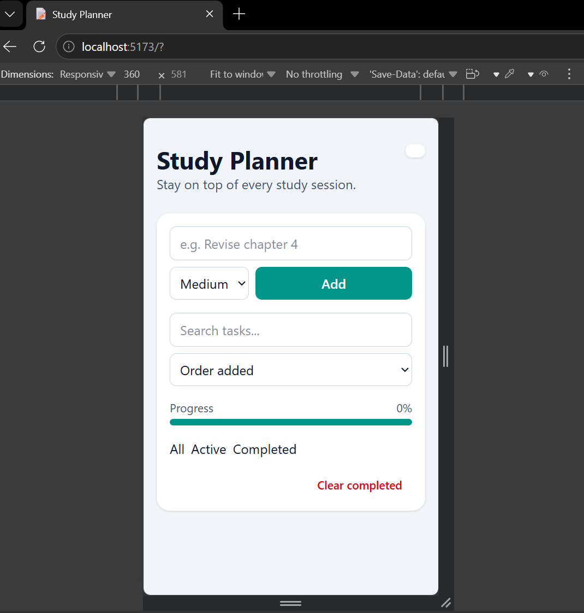
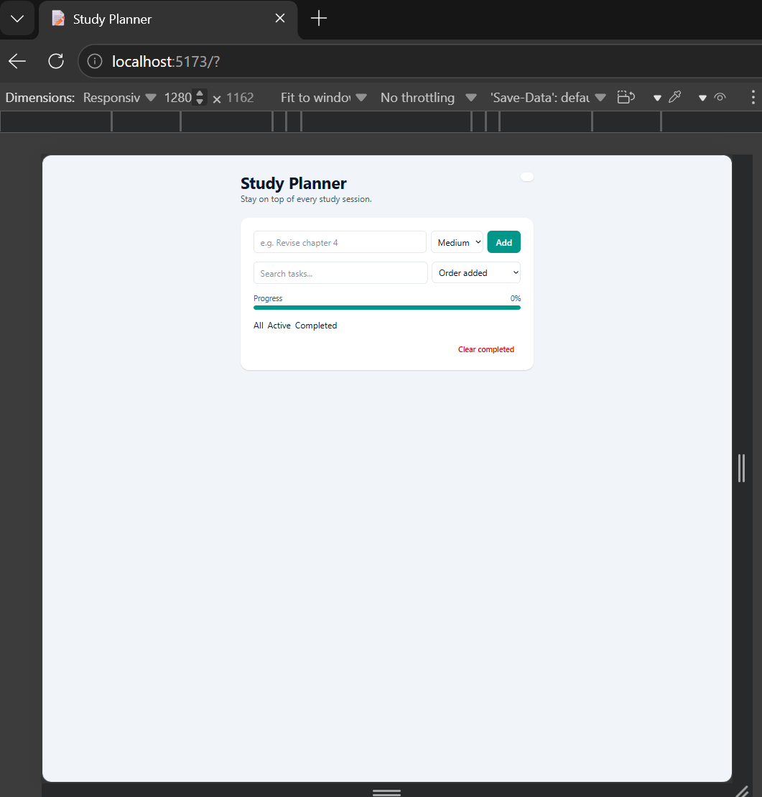

# Study Planner

A themed to-do list for students. Add study tasks, give them a priority, edit them in place, filter and search them, and everything is saved in your browser.

**Built by:** UTUJE ANGE FIDELE
**Course:** Advanced Frontend Web Development, Week 4

- **Live app:** https://week4todoapp.netlify.app
- **Video demo:** PASTE_VIDEO_LINK_HERE

Built with HTML, Tailwind CSS v4 (Vite) and vanilla JavaScript. No frameworks.

## Features

**Required**
1. Add a task (Enter or button, text is trimmed)
2. Validation: empty text or more than 100 characters shows an inline error (no `alert()`)
3. Complete / uncomplete with a checkbox; done tasks are crossed out
4. Delete with a `<dialog>` confirmation
5. Edit in place (double-click or Edit button; Enter saves, Escape cancels, empty text rejected)
6. Filters: All / Active / Completed, with the active one highlighted
7. Counter: "3 tasks left" / "1 task left"
8. Clear completed
9. Persistence: tasks and the selected filter survive a refresh (localStorage)
10. Friendly empty-state messages (different for no tasks, search, Active and Completed)

**Extra features (marked)**
- ⭐ **Priority** (High / Medium / Low) with colored badges and "sort by priority"
- ⭐ **Search box** that filters tasks as you type (`input` event)
- ⭐ **Dark mode** toggle that is remembered in localStorage

## User Stories
- As a student, I want to add a study task quickly so I do not forget it.
- As a student, I want to see an error if I type nothing, so I know why nothing was added.
- As a student, I want to tick off finished tasks so I can see my progress.
- As a student, I want to fix a typo in a task without deleting and retyping it.
- As a student, I want to confirm before deleting so I do not lose a task by accident.
- As a student, I want to filter Active and Completed tasks so I can focus on what is left.
- As a student, I want to mark tasks High priority and sort by it so I study the urgent ones first.
- As a student, I want to search my tasks so I can find one quickly.
- As a student, I want my tasks to be saved so they are still there tomorrow.
- As a student, I want a dark mode so I can study at night.

## State Shape
All data lives in one `state` object in `src/main.js`. Every action changes `state`, then calls `render(state)`.

```js
const state = {
  tasks: [],            // array of task objects (saved)
  filter: 'all',        // 'all' | 'active' | 'completed' (saved)
  sort: 'created',      // 'created' | 'priority' (saved)
  search: '',           // search box text
  edit: null,           // { id, draft, error } while editing
  pendingDeleteId: null,// task waiting for delete confirmation
  formError: '',        // error under the add form
};

// One task:
{
  id: "b1c2d3e4-...",   // crypto.randomUUID()
  text: "Revise chapter 4",
  done: false,
  priority: "high",     // "high" | "medium" | "low"
  createdAt: 1727600000000
}
```

## Project Structure
| File | Job |
|---|---|
| `index.html` | Page structure, labeled form, `<dialog>` |
| `src/main.js` | State, event handlers (with event delegation), start-up |
| `src/tasks.js` | Pure logic: validate, create, toggle, edit, filter, sort |
| `src/render.js` | Draws the UI from state (uses `textContent` only) |
| `src/storage.js` | localStorage + JSON for tasks, filter and theme |
| `src/style.css` | Tailwind import, dark-mode variant, focus styles |

## Screenshots
| Mobile (360px) | Desktop (1280px) |
|---|---|
|  |  |

## Challenges and What I Learned
WRITE 5-8 SENTENCES IN YOUR OWN WORDS. Include one real bug you fixed with DevTools (what you saw, which DevTools panel you used, and how you fixed it).

## How to Run Locally
```bash
git clone https://github.com/utuje-ange12/week4-todo-app.git
cd week4-todo-app
npm install
npm run dev      # open the local address shown in the terminal
npm run build    # production build in /dist
```
